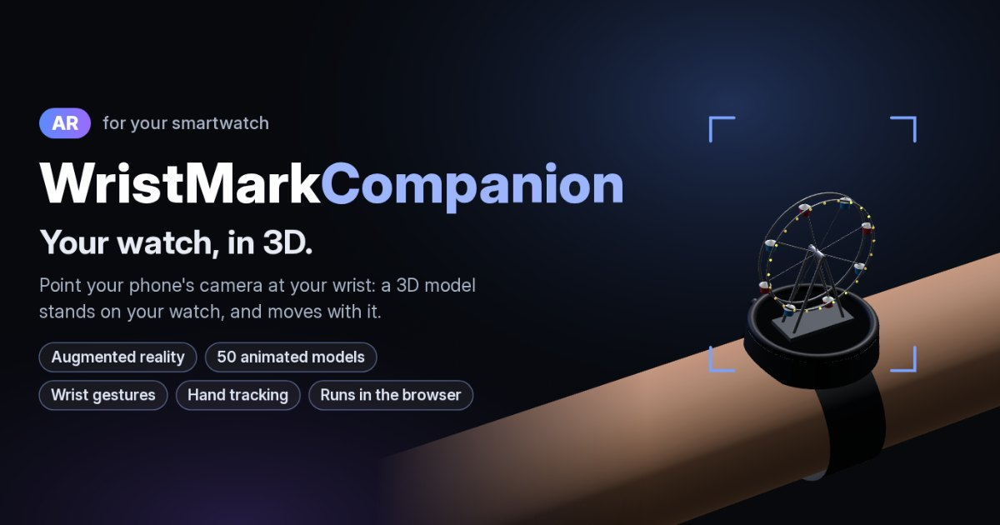

# WristMarkCompanion

**Your watch, in 3D.** Point your phone's or laptop's camera at your watch, and a 3D model comes
alive on your wrist: tonight's moon, the planets as they stand today, a campfire, dice you roll
with a flick of the wrist.

## Use it

1. Open **WristMarkCompanion** on the watch: it shows a marker.
2. Open the viewer, <https://wristmark.apps.ciepiela.org>, on a phone or a laptop with a camera,
   and tap **Start the camera**.
3. Point the camera at the watch. Its buttons switch to the next model.

The [user guide](docs/user/guide.md) has the gestures, the tips for a steady model and what to do
when something doesn't work. No watch at hand? The viewer's **Markers** page shows them on any
screen.

- **50 models, one for every marker**, all made in code: the sky (the moon's phase, the Earth with
  day and night, the planets, a world clock, a satellite, a black hole), time (a watch movement, an
  hourglass, a sundial, a metronome), science (an atom, DNA, a Newton's cradle, a puzzle cube that
  solves itself), flight (an attitude indicator, a landing, a helicopter, a balloon, a rocket
  launch, a UFO), places (a windmill, a sailboat, a Ferris wheel, a carousel, a race track, a
  castle, a house, a bonsai through the seasons, a volcano, a lighthouse, a rain cloud) and fun
  (dice, a marble maze, fireworks, a tornado, a snowman, a campfire, an aquarium, a jellyfish,
  butterflies, a lava lamp, a treasure chest, a robot, Tux the Linux penguin, a Tyrannosaurus rex,
  Glimmer the crystal-tailed creature, a toy train, a gumball machine).
  [The full list](docs/user/models.md).
- **Move your wrist:** flick, shake or twist it, and the model reacts. Buttons do the same.
- **Any size:** pinch, scroll or `+` and `−`; full screen with `F`.
- **Private:** the camera's image is processed in the browser and never leaves the device. No
  account, no tracking ([privacy](viewer/public/privacy.html)).

## How it works

The watch shows an ArUco marker. The viewer, a static web page, finds it in the camera image
(js-aruco2), works out where the watch is and how it's turned, and draws the model for that
marker's ID on top of it (three.js). The marker ID is all the viewer needs.

Pair the watch with the viewer (through the camera, encrypted end to end) and the viewer can steer
it too: the next model, the automatic cycle, a buzz to find it.

## Documentation

- **Using it:** the [user guide](docs/user/guide.md) and [the models](docs/user/models.md).
- **Developing it:** [`docs/dev/`](docs/dev/README.md): the architecture, the repository's layout,
  the watch app, the viewer's content and interaction, Android, CI, deployment, publishing,
  device tests and decisions.

## License

GPL-3.0 ([`LICENSE`](LICENSE)). Third-party parts keep their own licenses: js-aruco2 (MIT) and
the OpenCV ArUco dictionary (3-clause BSD, its notice is in
`watch/source/MarkerDictionary.mc`).
