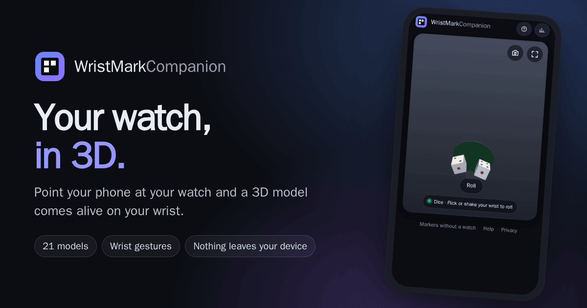

# WristMarkCompanion

**Your watch, in 3D.** Point your phone's or laptop's camera at your watch, and a 3D model comes
alive on your wrist: tonight's moon, the planets as they stand today, a campfire, dice you roll
with a flick of the wrist.



## Use it

1. Open **WristMarkCompanion** on the watch: it shows a marker.
2. Open the viewer, <https://wristmark.apps.ciepiela.org>, on a phone or a laptop with a camera,
   and tap **Start the camera**.
3. Point the camera at the watch. Its buttons switch to the next model.

The [user guide](docs/user-guide.md) has the gestures, the tips for a steady model and what to do
when something doesn't work. No watch at hand? The viewer's **Markers** page shows them on any
screen.

- **21 models**, all made in code: the sky (the moon's phase, the Earth with day and night, the
  planets, a world clock), time (a watch movement, an hourglass), flight (a landing, a
  helicopter, a balloon, a rocket launch) and fun (dice, fireworks, a snow globe, a campfire, an
  aquarium, a lighthouse, a robot). [The full list](docs/content.md#the-models).
- **Move your wrist:** flick, shake or twist it, and the model reacts. Buttons do the same.
- **Any size:** pinch, scroll or `+` and `−`; full screen with `F`.
- **Private:** the camera's image is processed in the browser and never leaves the device. No
  account, no tracking ([privacy](viewer/public/privacy.html)).

## How it works

The watch shows an ArUco marker. The viewer, a static web page, finds it in the camera image
(js-aruco2), works out where the watch is and how it's turned, and draws the model for that
marker's ID on top of it (three.js). There is no connection between the two: the marker ID is the
only data channel.

Status: **device tests on the D2 Mach 1** ([device tests](docs/device-tests.md)): the viewer
tracks the watch's marker well; the guided test (`?test`) measures range, angles, the display's
session and every model. Next: more models for the remaining marker IDs, and an
[encrypted channel](docs/decisions/004-control-channel.md) to steer the watch from the viewer
(proposed).

## The project

| Part      | Where                | What                                                                                                                                                                                                                                                                                                            |
|-----------|----------------------|-----------------------------------------------------------------------------------------------------------------------------------------------------------------------------------------------------------------------------------------------------------------------------------------------------------------|
| Watch app | [`watch/`](watch/)   | Connect IQ device app (Monkey C), first target the D2 Mach 1                                                                                                                                                                                                                                                    |
| Viewer    | [`viewer/`](viewer/) | Static web app with js-aruco2 and three.js, served by nginx                                                                                                                                                                                                                                                     |
| Tools     | [`tools/`](tools/)   | The marker table and icon generators, the watch's build and simulator, smoke test                                                                                                                                                                                                                               |
| Docs      | [`docs/`](docs/)     | [User guide](docs/user-guide.md), [architecture](docs/architecture.md), [decisions](docs/decisions/), [content](docs/content.md), [interaction](docs/interaction.md), [watch](docs/watch.md), [CI](docs/ci.md), [deployment](docs/deployment.md), [publishing](docs/publishing.md), [review](docs/ux-review.md) |

## Development

```sh
npm ci --prefix viewer                        # the viewer's pinned libraries and lint tools
npm run --prefix viewer lint
node tools/generate-dictionary.mjs            # rewrite the watch's marker table
docker build -t wristmark-viewer:test viewer && tools/smoke-test.sh wristmark-viewer:test
```

## License

GPL-3.0 ([`LICENSE`](LICENSE)). Third-party parts keep their own licenses: js-aruco2 (MIT) and
the OpenCV ArUco dictionary (3-clause BSD, its notice is in
`watch/source/MarkerDictionary.mc`).
