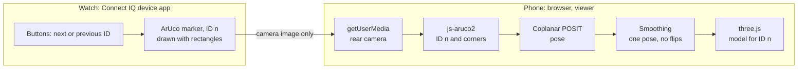

# Architecture

Two parts, with no link between them but the camera image:

- **The marker ID is the only data channel.** There is no Bluetooth, network or phone app.
  Everything the viewer shows is chosen by the ID it reads.
- **One dictionary on both sides.** The watch's table is generated from the viewer's library
  data ([002](decisions/002-marker-dictionary.md)).
- **Nothing leaves the browser.** The viewer is static files. Its Content-Security-Policy allows
  connections to its own origin only (`viewer/nginx.conf`), so no camera frame or analytics can
  be sent elsewhere.

## Repository layout

| Path                  | What                                                                                                                                                                                                                                                     |
|-----------------------|----------------------------------------------------------------------------------------------------------------------------------------------------------------------------------------------------------------------------------------------------------|
| `watch/`              | The Connect IQ project ([watch app](watch.md)). `source/MarkerDictionary.mc` is generated                                                                                                                                                                |
| `viewer/`             | The static web app (`public/`: the viewer `index.html`, the desktop marker page `markers.html`, `js/`, the [content mapping](content.md) `content.json`), its pinned libraries (`package.json`), nginx config, Dockerfile and end-to-end tests (`test/`) |
| `tools/`              | `generate-dictionary.mjs` (the watch's marker table), `smoke-test.sh` (the viewer's image), `align-tables.mjs` (Markdown tables), `build-watch.sh` (the watch app), `simulate.sh` (it in the simulator), `generate-icon.mjs` (its launcher icon)         |
| `docs/`               | This page, [the watch app](watch.md), [decisions](decisions/), [CI](ci.md), [content](content.md), [model ideas](model-ideas.md), the [device tests](device-tests.md); later the store guide                                                             |
| `.forgejo/workflows/` | CI                                                                                                                                                                                                                                                       |

## Decisions

- [001: Detection library: js-aruco2](decisions/001-detection-library.md)
- [002: Marker dictionary: OpenCV DICT_4X4_50](decisions/002-marker-dictionary.md)
- [003: Pose: coplanar POSIT, assumed intrinsics, flip-aware smoothing](decisions/003-pose.md)

## Planned

- [Interaction with the models](interaction.md): moving the watch, touch and clicks, and hand
  gestures only if they give the watch hand meaningful actions. After the device tests.
