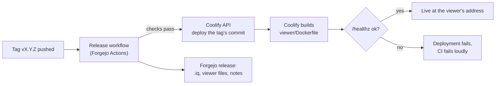

# Deployment and releases

Status: **decided on 2026-11-15, built, not yet run** (milestone 5). The release workflow
(`.forgejo/workflows/release.yml`) and the image's health check are in the repository; the app
host's side waits for HomeLab #126 and the app in the panel ([steps](#what-is-left-to-do)).

## The viewer on the app host

The homelab's app host runs [Coolify](https://coolify.io) at `https://apps.ciepiela.org`, and the
homelab's documentation describes how an app gets there (HomeLab
`docs/guides/maintainers/06_apps.md` and `docs/services/12_apps.md`). The viewer is a plain
`Dockerfile` app, so it needs nothing beyond what the other apps use.

### The mechanism: CI deploys through Coolify's API, on tags only

1. **Register the app** in HomeLab's `homelab_apps` (`group_vars/homelab/apps.yml`): name
   `wristmark` (the address), repository `dawid/wristmarkcompanion`, `probe: false`. This gives
   the private repository the app host's read-only deploy key and the Actions secret `APPS_TOKEN`
   automatically (`configure.yml --limit apps,forge --tags apps`). No secret to create by hand.
2. **Create the app in the panel** (by hand, once): *Private Git Repository (with Deploy Key)*,
   `git@git.ciepiela.org:dawid/wristmarkcompanion.git`, branch `main`, build pack Dockerfile, base
   directory `/viewer`, port 8080, named `wristmarkcompanion` like the repository. **Automatic
   deployment off**, so that pushes to `main` don't deploy.
3. **The release workflow** (on `v*` tags) runs the checks, then calls the API as the apps guide
   shows (`/api/v1/applications` for the UUID, `/api/v1/deploy?uuid=...`), pinned to the tag's
   commit, waits for the result and asks `/healthz`. HomeLab's `scripts/forgejo_apps.py` has the
   full step, which this would follow.

Why not a webhook: a webhook deploys every push to the branch, and the spec wants deploys on tags
only. CI on the tag deploys exactly the tagged commit, after its checks.

### With the relay {#with-the-relay}

The control channel ([004](decisions/004-control-channel.md)) needs its relay on the viewer's
origin. `compose.yaml` runs both: the viewer's image built with `RELAY=on`, whose nginx passes
`/relay/` to the relay's container (unbuffered, for the event stream and the long-poll; not in
its access log), and the relay, read-only, without capabilities. Only the viewer is exposed.
Without it (the plain `Dockerfile` app, `RELAY=off`), nginx answers the relay's health with
`"off"` and the viewer doesn't offer pairing; nothing else changes.

To switch the app over, in the panel (once, by hand):

1. The app's **build pack** from Dockerfile to **Docker Compose**, base directory `/`, compose
   file `compose.yaml`.
2. The app's **domain** on the service `viewer`, port 8080 (the relay gets none).
3. Deploy (the release workflow, or by hand). `https://<address>/relay/v1/healthz` then answers
   `{"status":"ok"}`, and the viewer shows its **Watch** button.

The relay keeps everything in memory: a restart or a new deployment drops the queues, and the
viewer and the watch create their channels again (`PUT`). If the app sleeps (`HOMELAB_SLEEP`),
the relay sleeps with it; a watch's long-poll wakes it like any request.

### Health check

The image has a `HEALTHCHECK` on `/healthz` (busybox `wget`, already in the image, as the smoke
test uses it; Docker reports the container `healthy`), and the release workflow asks `/healthz`
at the public address after the deployment and fails if it doesn't answer, waking the app if
it sleeps. Whether Coolify keeps the old container running when
the new one fails its health check is to be confirmed when it's set up.

### Rollback

- **Quick:** in the panel, the app's *Deployments*, redeploy the previous one.
- **Through CI:** run the release workflow by hand (`workflow_dispatch`) with the previous tag.
  For a tag that has its release already it publishes nothing (it asks the API first, since
  `forgejo-release` fails on an existing release), but it builds and deploys that tag's viewer
  again.
- Tags are never moved or deleted, so every released version can be deployed again.

### Sleeping

The app host can stop an app nobody requests and start it on the next request
(`HOMELAB_SLEEP=45m` in the panel; a few seconds' wait for the first visitor). The viewer is a
small nginx, so it could stay awake; sleeping is an option if it's rarely used.

## The address

| Option                                | What it takes                                                                                                                                                                             |
|---------------------------------------|-------------------------------------------------------------------------------------------------------------------------------------------------------------------------------------------|
| `wristmark.apps.ciepiela.org`         | Nothing: the wildcard `*.apps` record and Coolify's certificates cover it. Public, like every app                                                                                         |
| `wristmark.ciepiela.org` (the spec's) | A DNS record in HomeLab pointing at the app host, and the domain added in the panel. Not checked yet whether the homelab's DNS and the proxy's certificates allow it without more changes |

Either is public on the internet, not behind WireGuard: the apps are public (HomeLab
`docs/services/12_apps.md`, "The apps are public"). The viewer needs HTTPS for the camera, which
both have.

## What the privacy page must say

The viewer's own promise holds: no camera frame, no analytics and no request leaves the browser
except for the viewer's files. But serving those files is a request to the app host, and the
homelab's proxy keeps an access log:

- The proxy's access log holds visitors' **full IP addresses** until it is rotated; it stays on
  the server and isn't backed up.
- Coolify's traffic figures keep addresses **shortened** (anonymized), hourly for 30 days and
  daily for 395 days (HomeLab `docs/services/12_apps.md`, "Traffic analytics").

The privacy page, `viewer/public/privacy.html` (English and German), says this plainly beside
"what your camera sees stays on your device".

## Releases

On a `v*` tag, the release workflow:

1. Checks that `CHANGELOG.md` has a section for the version, and uses it as the release notes.
2. Builds the store package with `tools/build-watch.sh --package` (`monkeyc --package-app
   --release`, every product in the manifest, 9 KB for the D2 Mach 1), signed with the
   developer key from the Actions secret `CONNECTIQ_DEVELOPER_KEY`. That's the one secret the
   owner adds by hand: the key file (DER), base64-encoded. It's written to a temporary file for
   the build and deleted afterwards.
3. Builds the viewer's image, runs the smoke test on it, and packs the files it serves
   (`public/` and the vendored libraries) as a tarball.
4. Creates the Forgejo release with both attached, for tags only. Nothing else is uploaded, and
   no workflow artifacts are kept.
5. Deploys the viewer (above).

**Who tags:** the homelab's release bot, weekly, as in the other repositories with a
`.cz.toml`. It reads the Conventional Commits since the last tag (`feat` raises the minor
version, `fix` the patch; below 1.0.0 a breaking change raises the minor), writes the
version's section `## X.Y.Z - date` from the hand-written `## [Unreleased]` text, commits and
tags. A tag pushed by hand works the same. Every tag goes to the viewer's address and makes a
store package; uploading it to the store stays by hand ([publishing](publishing.md)).

The developer key must be backed up outside Forgejo: "If you lose your original signing key you
will not be able to update your app" (Garmin's Getting Started, [publishing](publishing.md)).

## Decisions

The owner decided on 2026-11-15:

| Question            | Decision                                                                                                      |
|---------------------|---------------------------------------------------------------------------------------------------------------|
| Address             | `wristmark.apps.ciepiela.org`: covered by the app host's wildcard, public                                     |
| Registering the app | HomeLab's `homelab_apps` entry: HomeLab #126                                                                  |
| Deploying           | CI through Coolify's API, on version tags only                                                                |
| The signing key     | The owner makes it and adds `CONNECTIQ_DEVELOPER_KEY` later ([publishing](publishing.md#2-the-developer-key)) |
| Sleeping            | The viewer sleeps when unused (`HOMELAB_SLEEP`)                                                               |
| Tagging (11-16)     | The release bot, from `.cz.toml`                                                                              |
| The name (11-16)    | WristMarkCompanion in the store, `wristmarkcompanion` the repository; the address stays `wristmark`           |

## What is left to do

1. Merge and deploy HomeLab #126 (its description has the commands): the repository gets the
   deploy key and `APPS_TOKEN`.
2. Create the app in the panel, once, as the apps guide's "Register the app" says: *Private Git
   Repository (with Deploy Key)*, key `forgejo`, `git@git.ciepiela.org:dawid/wristmarkcompanion.git`,
   branch `main`; build pack Dockerfile, base directory `/viewer`, port 8080; name
   `wristmarkcompanion` (CI finds the app by the repository's name), domain
   `https://wristmark.apps.ciepiela.org`; automatic deployment off;
   variable `HOMELAB_SLEEP=on`.
3. Make the developer key and add `CONNECTIQ_DEVELOPER_KEY`
   ([publishing](publishing.md#2-the-developer-key)).
4. The first release: the release bot tags it (below), or you push `v0.1.0` yourself. The
   release workflow fails loudly at the first step that's missing: the changelog section, the
   secret, or the app in the panel. **Do steps 1 to 3 before `.cz.toml` reaches `main`**, or
   the bot's next weekly run tags a release that fails; then run the workflow again by hand
   with that tag once they're done.
