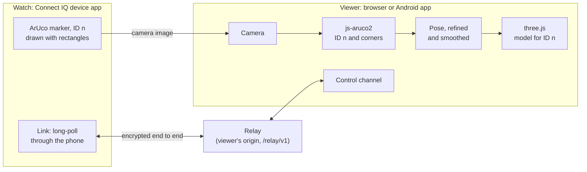

# Developer documentation

How WristMarkCompanion is built, tested and released. What people using it read is in
[`docs/user/`](../user/guide.md).

## Architecture



- **The marker ID chooses the model.** The camera image is all the viewer needs to show it.
- **One dictionary on both sides.** The watch's table is generated from the viewer's library
  data ([002](decisions/002-marker-dictionary.md)).
- **The control channel is optional:** paired through the camera, the viewer steers the watch
  (next, cycle, buzz) through the relay, which only passes encrypted messages on
  ([004](decisions/004-control-channel.md)).
- **No camera image leaves the device.** The viewer is static files; its Content-Security-Policy
  allows connections to its own origin only (`viewer/nginx.conf`).

## Repository layout

| Path                  | What                                                                                                |
|-----------------------|-----------------------------------------------------------------------------------------------------|
| `watch/`              | The Connect IQ app ([watch](watch.md)); `source/*.mc` generated where their header says so          |
| `viewer/`             | The web app: `public/` (pages, `js/`, `content.json`), nginx, Dockerfile, tests (`test/`), `tools/` |
| `relay/`              | The control channel's relay: Go, standard library only                                              |
| `app/`                | The viewer as an Android app, Capacitor ([Android](android.md))                                     |
| `protocol/`           | The control channel's test vectors, shared by the viewer's and the watch's tests                    |
| `tools/`              | Generators (`generate-*.mjs`, checked in CI), builds (`build-*.sh`), the simulator, the smoke test  |
| `docs/user/`          | What people using it read: the [user guide](../user/guide.md) and [the models](../user/models.md)   |
| `docs/dev/`           | This documentation                                                                                  |
| `.forgejo/workflows/` | CI and the release ([CI](ci.md))                                                                    |

## Pages

- [Watch app](watch.md): layout, controls, the display, devices, the viewer's address.
- [Content](content.md): the marker-to-model mapping, how the models are made, the debug overlay.
- [Interaction](interaction.md): the wrist's gestures, touch, the other hand.
- [Android](android.md): the app, its signing, F-Droid; [Google Play](google-play.md).
- [CI](ci.md), [deployment](deployment.md), [publishing to the Connect IQ Store](publishing.md)
  and its [assets](store-assets/).
- [Device tests](device-tests.md): the protocol and [the results](device-tests/).

## Decisions

- [001: Detection library: js-aruco2](decisions/001-detection-library.md)
- [002: Marker dictionary: OpenCV DICT_4X4_50](decisions/002-marker-dictionary.md)
- [003: Pose: coplanar POSIT, assumed intrinsics, flip-aware smoothing](decisions/003-pose.md)
- [004: Control channel](decisions/004-control-channel.md)

## Development

```sh
npm ci --prefix viewer                        # the viewer's pinned libraries and lint tools
npm run --prefix viewer lint
npm test --prefix viewer                      # every test, in Playwright's image: ci.md
docker build -t wristmark-viewer:test viewer && tools/smoke-test.sh wristmark-viewer:test
```

[CI](ci.md) lists every check it runs, to run them locally.
