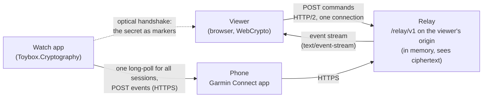
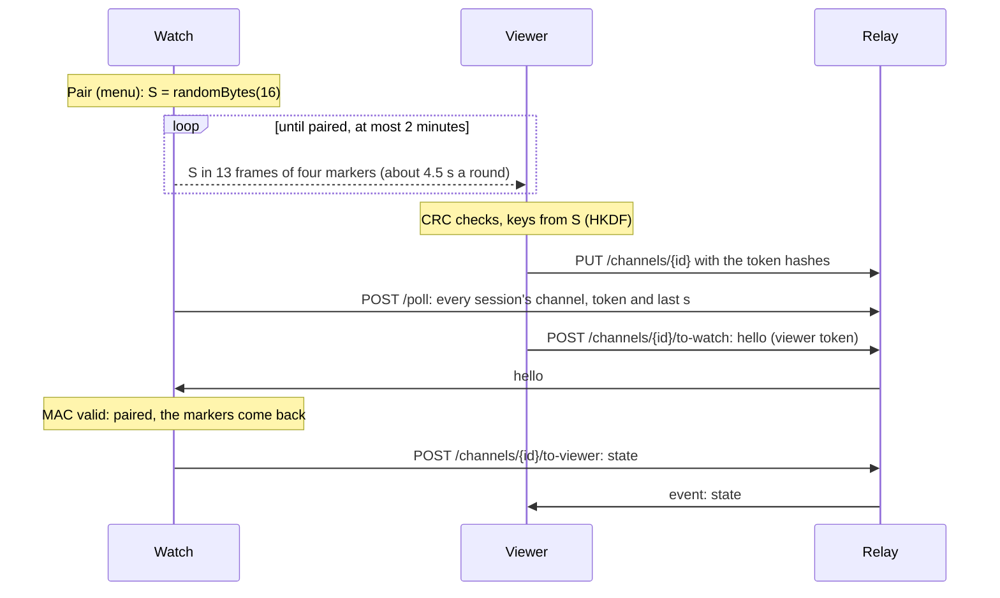

# 004: Control channel: the viewer steers the watch, end-to-end encrypted

Status: **built** (2026-11-17, release 0.2.0), with the owner's [decisions](#decisions);
proposed on 2026-11-16.

## Goal

The viewer can send commands to the watch app (show marker 12, start the cycle, vibrate), and the
watch can send events back (a button was pressed, the marker changed). The two pair with an
**optical handshake**: the watch shows a secret, the viewer's camera reads it. Every message is
encrypted and authenticated end to end, so the server that relays them learns nothing but
sizes and timing.

## Decisions

Made on 2026-11-16:

| Question                  | Decision                                                                                                                                                                                                                              |
|---------------------------|---------------------------------------------------------------------------------------------------------------------------------------------------------------------------------------------------------------------------------------|
| How the secret is shown   | **Indexed frames of four markers** ([pairing](#pairing-the-optical-handshake)): the detector the viewer already has, error-corrected per marker, and frames read in any order, so a missed one costs a third of a second, not a round |
| Where the relay runs      | **Beside the viewer, one Compose app of two containers** ([the relay](#the-relay-itself))                                                                                                                                             |
| Whether a session is kept | **Kept, several at once, expiring by age** ([sessions](#sessions)): pairing another viewer adds a session instead of replacing one; a session ends 7 days after its last use, or 30 days after pairing                                |

## What the platforms allow

Checked on 2026-11-16 against Garmin's API reference
([Communications](https://developer.garmin.com/connect-iq/api-docs/Toybox/Communications.html),
[Cryptography](https://developer.garmin.com/connect-iq/api-docs/Toybox/Cryptography.html),
[HMAC](https://developer.garmin.com/connect-iq/api-docs/Toybox/Cryptography/HashBasedMessageAuthenticationCode.html),
[StringUtil](https://developer.garmin.com/connect-iq/api-docs/Toybox/StringUtil.html)).

| Constraint                      | What it means                                                                                                                                                                                          |
|---------------------------------|--------------------------------------------------------------------------------------------------------------------------------------------------------------------------------------------------------|
| The watch can't be reached      | No incoming connections. It can only make requests itself: `makeWebRequest`, "when connected to WiFi or a mobile device over Bluetooth" (through the Garmin Connect app on the phone)                  |
| Requests                        | GET, PUT, POST, DELETE; bodies JSON or URL-encoded; responses JSON, text or bytes. **No documented timeout or size limit** (only the errors `NETWORK_REQUEST_TIMED_OUT`, `NETWORK_RESPONSE_TOO_LARGE`) |
| Parallel requests               | "Limited"; too many give `BLE_QUEUE_FULL`. One request in flight at a time                                                                                                                             |
| Crypto on the watch (API 3.0.0) | AES-128/256 in **ECB or CBC only** (no GCM); SHA-256; HMAC with **SHA-256 only**; ECDH on secp224r1 and secp256r1; `randomBytes` ("cryptographically random")                                          |
| Base64 on the watch             | `StringUtil.convertEncodedString` between `REPRESENTATION_STRING_BASE64` and `REPRESENTATION_BYTE_ARRAY` (API 3.0.0; the pair is to be verified on the device)                                         |
| Permission                      | `Communications` in the manifest; the store shows it. The app's `minApiLevel` 3.3.0 covers everything above                                                                                            |
| The watch has no camera         | The optical channel runs one way only: watch to viewer                                                                                                                                                 |
| The viewer's CSP                | `connect-src 'self'`: the relay must be on the viewer's own origin, which keeps "nothing leaves for another server" true                                                                               |
| Browsers                        | WebCrypto has HKDF, HMAC, AES-CBC and `getRandomValues` everywhere the viewer runs; `fetch` with a streamed body reads server-sent events with headers, which `EventSource` can't send                 |

## Overview



- **Viewer to watch:** the viewer POSTs an encrypted command; the relay answers the watch's
  waiting long-poll at once.
- **Watch to viewer:** the watch POSTs an encrypted event; the relay pushes it down the viewer's
  open event stream. The viewer never polls.
- **The relay** holds a few messages per channel in memory for minutes, and knows neither the
  secret nor the keys.

## Pairing: the optical handshake



**The watch's secret.** Pairing starts on the watch (a menu entry), which draws a fresh 128-bit
secret `S` from `randomBytes`. `S` exists only in the watch's and the viewer's memory, for one
session; it is never sent over a network.

**Frames of four markers carry it.** The viewer already decodes the watch's DICT_4X4_50 markers
reliably and finds several in one image, so the handshake reuses them instead of adding a second
code type (a QR code would need an encoder on the watch and a decoder library in the viewer):

- **A frame** is a 2x2 grid of markers, each with its quiet zone, about 9 mm wide on the D2
  Mach 1. The top left one is the frame's index (IDs 32-44 for frames 0-12); the other three
  carry 4 bits each (IDs 0-15), read left to right, top to bottom. The index marker's corners
  tell the viewer which way up the frame is.
- **A round** is 13 frames: a version (4 bits), `S` (128 bits) and a CRC-16 over both (16
  bits), 148 bits in 156. Each frame shows for a third of a second (about ten camera frames), so
  a round takes about 4.5 seconds and repeats until pairing succeeds or two minutes pass.
- **In any order:** the viewer keeps each frame index's latest reading, from whichever round it
  saw it in, and checks the CRC once all 13 are there; on a mismatch it keeps reading and votes
  per frame. A blurred or missed frame comes round again 4.5 seconds later.
- **Closer than for the models:** the markers are half the size of the single one, so pairing
  happens at about 15 to 25 cm; the status shows how many of the 13 frames it has.

**Keys.** Both sides derive everything from `S` with HKDF-SHA256 (RFC 5869; on the watch from its
HMAC class, two HMAC calls per output; in the viewer `crypto.subtle.deriveBits`), salt
`wristmark/channel/v1`:

| `info`          | Bytes | Use                                                        |
|-----------------|-------|------------------------------------------------------------|
| `id`            | 16    | The channel's ID in the relay's paths (base64url)          |
| `token/watch`   | 32    | The watch's bearer token; the relay keeps only its SHA-256 |
| `token/viewer`  | 32    | The viewer's bearer token, likewise                        |
| `to-watch/enc`  | 32    | AES-256 key, viewer to watch                               |
| `to-watch/mac`  | 32    | HMAC-SHA256 key, viewer to watch                           |
| `to-viewer/enc` | 32    | AES-256 key, watch to viewer                               |
| `to-viewer/mac` | 32    | HMAC-SHA256 key, watch to viewer                           |

Separate keys per direction mean a message can't be reflected back to its sender, and each side
only ever encrypts with its own key.

## Messages

**The envelope** is JSON, since `makeWebRequest` sends and parses JSON natively:

```json
{
  "v": 1,
  "r": "<8 bytes, base64>",
  "s": 42,
  "ts": 1794873600,
  "iv": "<16 bytes, base64>",
  "c": "<ciphertext, base64>",
  "t": "<16 bytes, base64>"
}
```

- **Encryption:** AES-256-CBC with a random IV per message and PKCS#7 padding, then
  **HMAC-SHA256 over the version, the direction, `r`, `s`, `ts`, the IV and the
  ciphertext**, truncated to 16 bytes (encrypt-then-MAC). GCM would be the first choice, but
  the watch has only ECB and CBC; encrypt-then-MAC with independent keys is the standard sound
  composition for CBC.
- **Order and replays:** `r` is the sender's run, random each time the app or page starts, and
  `s` counts up from 1 within it; `ts` is the sender's clock in Unix seconds. A receiver drops an
  envelope whose tag doesn't verify (in constant time, before decrypting), whose `ts` is more than
  2 minutes off its own clock, or whose `s` isn't above the last it accepted in that run.
  Counters needn't survive a restart: a new run starts at 1, and the clock check keeps an old
  run's envelopes from being replayed later.
- **Plaintext** is compact JSON, a command or an event, under 200 bytes:

| Direction       | `op`     | Fields                   | Meaning                                                          |
|-----------------|----------|--------------------------|------------------------------------------------------------------|
| viewer to watch | `hello`  | `name`                   | Pairing confirmed; the watch shows "Connected" and the viewer    |
| viewer to watch | `show`   | `id`                     | Show this marker                                                 |
| viewer to watch | `step`   | `delta`                  | Next (1) or previous (-1) marker                                 |
| viewer to watch | `cycle`  | `on`                     | Start or stop the automatic cycle                                |
| viewer to watch | `buzz`   | `ms`                     | Vibrate (`Attention.vibrate`), e.g. to find the watch            |
| viewer to watch | `bye`    |                          | Unpair; the watch forgets `S`                                    |
| watch to viewer | `state`  | `id`, `cycle`, `battery` | After pairing and every change                                   |
| watch to viewer | `button` | `key`                    | A button the app doesn't use itself: the viewer's remote control |
| watch to viewer | `bye`    |                          | The app closed or unpaired                                       |

The watch's buttons as a remote control give the [interaction](../interaction.md) a second
input besides the wrist's movements.

## Test vectors

The bytes, exactly, so that the two sides agree (`viewer/public/js/channel.js`, the watch's to
come):

- **HKDF-SHA256** with `S` as the input key, the salt and the `info` as UTF-8.
- **The channel's ID** (16 bytes) and **the tokens** (32 bytes) travel as unpadded base64url; the
  relay keeps the SHA-256 of a token's text, in hex.
- **The tag** is the first 16 bytes of HMAC-SHA256 over the version (1 byte), the direction (1
  byte: 1 toward the watch, 2 toward the viewer), `r` (8 bytes), `s` and `ts` (4 bytes each,
  unsigned big-endian: the watch's `ByteArray.encodeNumber` writes no wider; `ts` lasts to 2106),
  the IV and the ciphertext. `r`, the IV, the ciphertext and the tag travel as standard base64.
- **The plaintext** is the message's compact JSON in UTF-8.

`protocol/channel-vectors.json` holds, from a fixed `S`, the derived ID, tokens, hashes and keys,
five envelopes sealed with fixed runs, counters, times and IVs, and nine a receiver must refuse,
with the reason (tag, clock, replay, version). `tools/generate-channel-vectors.mjs` makes it with
Node's crypto, an implementation of its own: the viewer's tests check WebCrypto against it byte
for byte, and the watch's unit tests are to check `Toybox.Cryptography` against the same file
(decrypting and comparing the messages, since the watch writes its JSON by hand). CI fails while
the file is stale.

## The relay's API

Base path `/relay/v1`, on the viewer's origin. Every response is JSON with `Cache-Control:
no-store`; errors are RFC 9457 problem details (`application/problem+json`). The bearer tokens
are checked against the hashes the channel was created with.

| Method and path                 | Who    | Request                                                | Response                                                                                                                                                                  |
|---------------------------------|--------|--------------------------------------------------------|---------------------------------------------------------------------------------------------------------------------------------------------------------------------------|
| `PUT /channels/{id}`            | either | `{"watch": sha256, "viewer": sha256}`                  | 201 created, 204 the same hashes again, 409 other hashes                                                                                                                  |
| `POST /channels/{id}/to-watch`  | viewer | an envelope                                            | 202 `{"q": 42}`, its place in the queue; 429 when 64 wait                                                                                                                 |
| `POST /poll`                    | watch  | `{"wait": 25, "channels": [{"id", "token", "after"}]}` | 200 `{"messages": {"<id>": [...]}}` as soon as any channel has one, else empty after `wait` (at most 25 s); a channel the relay lost (a restart) is listed in `"unknown"` |
| `POST /channels/{id}/to-viewer` | watch  | an envelope                                            | 202                                                                                                                                                                       |
| `GET /channels/{id}/to-viewer`  | viewer | `Accept: text/event-stream`, `Last-Event-ID`           | An event stream: one `data:` line per envelope, its place `q` as the event's ID; a comment every 15 s keeps proxies from closing it                                       |
| `DELETE /channels/{id}`         | either |                                                        | 204; the channel and its queues are gone                                                                                                                                  |
| `GET /healthz`                  | anyone |                                                        | 200                                                                                                                                                                       |

- **Places in a queue:** the relay numbers each queue's messages, `q` from 1. The long-poll
  answers each as `{"q": 7, "e": <envelope>}`; the watch's `after` is the last `q` it has, which
  acknowledges it, and the viewer resumes the stream from the last `q` it read. The envelope's own
  `s` is the sender's counter, which only the receiver checks.
- **One long-poll for all of the watch's sessions:** the watch may have only one request in
  flight, so `POST /poll` waits on every channel it lists (each with its own token, at most four)
  and answers when any has a message. It's a POST because the tokens belong in the body, not in a
  URL that proxies might log.
- **Always 200 with JSON for the watch,** also when a long-poll ends empty: the watch's
  `makeWebRequest` handles JSON bodies best, and an empty 204 gains nothing.
- **Either side re-creates a channel** with `PUT` (both know the token hashes), so a channel
  the relay forgot, after a restart or 15 idle minutes, comes back without pairing again.
- **The viewer reads the stream with `fetch`,** not `EventSource`, because only `fetch` can send
  the `Authorization` header; it parses `text/event-stream` from the response's `ReadableStream`
  and resumes with `Last-Event-ID` after a drop.
- **Limits:** bodies up to 2 KB, 64 queued messages per direction, 10 messages a second per
  channel, channels gone after 15 minutes without a request. All in memory: a restart loses the
  queues, and the next `PUT` brings the channel back.

## Sessions

A pairing is a session: `S` and what HKDF derives from it, kept on both sides so that closing the
app or reloading the page doesn't mean pairing again.

- **Several at once:** pairing another viewer (another phone, a laptop) adds a session; it never
  replaces one. The watch keeps at most four; a fifth pairing drops the one used longest ago.
- **Expiry by age:** a session ends 7 days after its last use (a message either way) or 30 days
  after its pairing, whichever comes first; both sides check when they start and delete it. The
  watch's menu lists the sessions by the viewer's name (from its `hello`) and forgets one or all;
  `bye` ends one from either side.
- **On the watch:** `Application.Storage` holds each session's `S`, its pairing time, its last
  use and the viewer's name. Writes happen at pairing and when the app closes, not per message.
- **In the viewer:** the derived keys go into IndexedDB as **non-extractable** `CryptoKey`s
  (WebCrypto keeps their bytes from the page's own script), the tokens and the channel ID beside
  them; `S` itself isn't kept. The privacy page says so.
- **The watch polls only while the app is open,** for all of its sessions in one request, so a
  stored session costs nothing while the app is closed.

## Fast and light

| Path            | Steps                                                                                                      | Expected                                                         |
|-----------------|------------------------------------------------------------------------------------------------------------|------------------------------------------------------------------|
| Viewer to watch | POST on the open HTTP/2 connection; the relay answers the waiting long-poll; phone to watch over Bluetooth | Bluetooth dominates: to be measured; aim under 1 s at the median |
| Watch to viewer | POST from the watch through the phone; the relay writes it to the open event stream                        | The same Bluetooth hop, the push itself milliseconds             |
| Idle            | One long-poll held by the watch, renewed every `wait` seconds; one stream to the viewer                    | No polling loop on either side                                   |

- **Long-polling,** not a request a second: a command reaches the watch as soon as it's sent,
  and an idle channel costs one request per `wait`. The phone proxy's timeout is undocumented,
  so the watch starts with `wait=25` and halves it after each `NETWORK_REQUEST_TIMED_OUT`.
- **Only in the foreground:** the watch polls only while the app is open and paired, and stops
  in `onHide`. The device tests measure what it costs in battery.
- **Small:** envelopes are under 400 bytes; the browser side keeps one HTTP/2 connection (or
  HTTP/3 where the proxy offers it) for the stream and the POSTs.

## The relay itself

A small Go program (standard library only: `net/http` with HTTP/2, a map of channels behind a
mutex, a channel per waiting long-poll to wake it). About 300 lines, a static binary in a
`scratch` image of a few megabytes, no database, and no logging of bodies, tokens or IDs.

It runs beside the viewer: the app becomes a Compose app of two containers, nginx serving the
viewer and passing `/relay/` to the relay (with buffering off for the event stream), so the
origin, the CSP and the panel's single domain stay as they are.

## Threat model

| Who                                       | Can                                                                              | Can't                                                   | Mitigation                                                                                                     |
|-------------------------------------------|----------------------------------------------------------------------------------|---------------------------------------------------------|----------------------------------------------------------------------------------------------------------------|
| The relay, or someone who took it over    | See channel IDs, IP addresses, sizes and timing; drop, delay or repeat envelopes | Read or forge a message; replay one (the counter)       | End-to-end encryption and MACs; nothing kept beyond 15 minutes                                                 |
| The phone and its Garmin Connect app      | See the watch's requests: the relay's address and ciphertext                     | Read or forge a message                                 | As above                                                                                                       |
| Someone on the network                    | See TLS traffic                                                                  | Anything else                                           | HTTPS on every hop, then the end-to-end layer                                                                  |
| Someone filming the watch while pairing   | Read `S`, and with it use or read that session                                   | Pair later sessions (a new `S` each time)               | Pairing only on request and for 2 minutes; the watch lists every session by name; forgetting one ends it       |
| Anyone who guesses or learns a channel ID | Nothing: every request needs a token                                             | Post, read or delete                                    | Tokens from `S`, only their hashes on the relay; rate limits                                                   |
| Someone with the watch in hand            | Read its stored sessions' secrets and act as the watch toward those viewers      | Pair as a viewer without the watch showing a new secret | Sessions expire (7 days unused, 30 at most); forgetting them on the watch, or `bye` from the viewer, ends them |
| Someone with the viewer's browser         | Use the stored session to send commands                                          | Copy the keys elsewhere (non-extractable)               | The same expiry; the watch's menu forgets the session                                                          |

## Privacy and the store

- **The privacy page changes:** the relay processes the IP addresses of the viewer and of the
  phone, the channel ID and the timing, in memory for at most 15 minutes; the messages are
  encrypted end to end and the relay can't read them. The pairing is optional: without it,
  nothing is sent, as now.
- **The store:** the manifest declares `Communications`; the listing says what it's for.

## Options considered

| Option                                                | Why not (now)                                                                                                                                                                                         |
|-------------------------------------------------------|-------------------------------------------------------------------------------------------------------------------------------------------------------------------------------------------------------|
| Web Bluetooth straight to the watch                   | A Connect IQ app can't advertise a service to connect to, and Safari on iOS has no Web Bluetooth                                                                                                      |
| A companion phone app (`registerForPhoneAppMessages`) | Needs a native iOS and Android app beside Garmin Connect                                                                                                                                              |
| WebSocket or WebTransport for the viewer              | One direction needs pushing, which an event stream over HTTP/2 does with plain HTTP through every proxy; WebTransport lacks Safari support                                                            |
| A QR code                                             | One frame instead of about 4.5 seconds, but a QR encoder on the watch and a decoder in the viewer (`BarcodeDetector` is missing on iOS, so a library), and a code type not yet tested on this display |
| One marker at a time (the first draft)                | 37 symbols in a row, where one missed spoils the round; the indexed frames are read in any order                                                                                                      |
| ECDH (P-256 on both sides)                            | Forward secrecy within a session, but the keys still need the optical channel to be authenticated, and `S` already lives for one session only; a v2 could add it                                      |
| AES-GCM                                               | Not on the watch                                                                                                                                                                                      |

## Plan

Built so far:

- **The relay** (`relay/`, step 3), with its tests and its image, and `compose.yaml` to run it
  beside the viewer ([deployment](../deployment.md#with-the-relay)); not deployed yet. Until it
  is, nginx answers its health with `{"status":"off"}` and the viewer doesn't offer pairing.
- **The cryptography** and the shared test vectors (step 2), with the pairing frames.
- **The viewer's side** (step 4): pairing through the camera (`js/pairing.js`), the session in
  IndexedDB, the relay and its stream, and the control panel (`js/remote.js`). An end-to-end test
  plays the frames through Chromium's fake camera and the relay through `page.route`.
- **The watch's side** (step 4): the pairing screen, the sessions, the link and the commands,
  with unit tests against the vectors. Written without the SDK: never compiled yet.

1. **Spike on the D2 Mach 1** (with a test relay on studio): how long the phone proxy holds a
   long-poll, the latency each way (median and 95th percentile), whether `Cipher` in CBC mode
   pads by itself, and the base64 conversion. Its numbers replace the guesses above.
2. **Shared test vectors** (HKDF outputs, envelopes) in one JSON file, checked by the viewer's
   tests and by Monkey C unit tests (`Toybox.Test`, in the simulator), so both sides agree byte
   for byte.
3. **The relay** with its tests (pairing, long-poll wake-up, the stream's resume, the limits),
   and the Compose app.
4. **The viewer's pairing** (reading the frames, the progress, then a remote control panel)
   and **the watch's** (the pairing screen, the sessions and their menu, polling, the commands).
5. **The privacy page, the store listing, the device tests** (latency, battery).

## Open questions

- How long does the Garmin Connect app hold a request open, on iOS and on Android?
- Does the watch's AES-CBC pad by itself, or expect whole blocks?
- Are four 9 mm markers at three frames a second read reliably at about 20 cm, also in red
  light? The guided test can measure it, with a pairing step.
- How large may the watch's JSON request body be? `POST /poll` with four sessions is about
  600 bytes.
