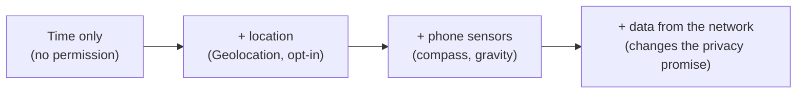

# Model ideas

Status: **ideas, none built** beyond the four placeholders ([content](content.md)). For the
owner to choose from; nothing here is decided.

The marker ID is the only data from the watch, so a model can use only what the viewer itself
knows. That sorts the ideas by what they need, and so by cost:

## What a model can know

| Input                              | Phone | Laptop  | Cost                                                                                                                                         |
|------------------------------------|-------|---------|----------------------------------------------------------------------------------------------------------------------------------------------|
| The time                           | Yes   | Yes     | None                                                                                                                                         |
| The time zone (`Intl`)             | Yes   | Yes     | None. Gives a rough longitude, enough for a globe's "you are here"                                                                           |
| The watch's pose and its movements | Yes   | Yes     | None: the tracker has it every frame ([interaction](interaction.md))                                                                         |
| Touch, clicks                      | Yes   | Yes     | None                                                                                                                                         |
| A file the user picks (GPX, IGC)   | Yes   | Yes     | None: read in the browser, never uploaded                                                                                                    |
| Location                           | Yes   | Roughly | A permission prompt, and `nginx.conf`'s `Permissions-Policy` (now `geolocation=()`) opened. Stays in the browser                             |
| Compass and gravity                | Yes   | No      | `DeviceOrientationEvent` (iOS asks for permission). A laptop has neither: the model needs a fallback (camera assumed upright, no north)      |
| Live data (flights, weather)       | Yes   | Yes     | A request to a server, with the location in it. Breaks "nothing leaves the browser" unless the owner decides otherwise ([below](#live-data)) |

## Utilities

| Idea                         | Needs                   | What it shows                                                                                                              |
|------------------------------|-------------------------|----------------------------------------------------------------------------------------------------------------------------|
| **Moon phase**               | Time                    | The moon lit as it is tonight, turning to show the phase; the next full and new moon as labels                             |
| **Earth with day and night** | Time (+ time zone)      | A globe whose lit half follows the sun's position now, the terminator moving in real time, a dot at the viewer's time zone |
| **Solar system (orrery)**    | Time                    | The planets at today's positions around the sun, from published orbital elements; scrub time by turning the wrist          |
| **Sun path**                 | Time, location          | Today's arc of the sun over a small landscape on the watch, the sun at its current place, sunrise and sunset, golden hour  |
| **Sky dome**                 | Time, location, compass | The bright stars and constellations above, a dome over the watch, turned to north (phone only)                             |
| **World clock**              | Time                    | A ring of time zones around a small globe, the local hour of a few cities                                                  |
| **Timer hourglass**          | Time, touch             | An hourglass; tap to start a countdown, turn the wrist upside down to restart it                                           |

The moon, the globe and the orrery need no permission and work on a laptop, so they're the
natural first ones. Their math (the sun's and moon's positions, Meeus-style low-precision
formulas) is a few hundred lines of code, with no data files. The globe's continents need an
outline: Natural Earth's (public domain), simplified to tens of kilobytes, or a texture (NASA
Blue Marble, public domain), a few hundred kilobytes, which needs the owner's approval.

## Aviation

The D2 Mach 1 is an aviator's watch, so aviation fits it.

| Idea                       | Needs               | What it shows                                                                                                                                                                                           |
|----------------------------|---------------------|---------------------------------------------------------------------------------------------------------------------------------------------------------------------------------------------------------|
| **Attitude indicator**     | Pose (+ gravity)    | An artificial horizon that follows the wrist like an aircraft's attitude: bank and pitch from the watch's pose. With the phone's gravity sensor it's true attitude; on a laptop, relative to the camera |
| **Flight replay**          | A file (IGC, GPX)   | A recorded flight as a 3D track with altitude over the watch, a small plane flying it; scrub by turning the wrist                                                                                       |
| **Crosswind calculator**   | Touch               | A runway and a wind arrow set by dragging; headwind and crosswind components shown                                                                                                                      |
| **Landing demo**           | Nothing             | A runway on the watch, a plane flying an approach and landing, looping                                                                                                                                  |
| **Live traffic around me** | Location, live data | Aircraft nearby as small planes at their bearing and altitude ([live data](#live-data))                                                                                                                 |

## Navigation

| Idea                 | Needs                            | What it shows                                                                                           |
|----------------------|----------------------------------|---------------------------------------------------------------------------------------------------------|
| **Where did I park** | Location, compass                | Save the spot with a tap; later an arrow on the watch points back to it, with the distance (phone only) |
| **Activity in 3D**   | A file (GPX from Garmin Connect) | A run, ride or hike as a 3D track with elevation, an avatar moving along it                             |
| **Arrow to a place** | Location, compass                | An arrow toward a destination typed in as coordinates (no address search: that would need a server)     |

Car navigation proper (a route on a map) needs map data and routing from a server, so it
belongs with [live data](#live-data).

## For fun

These use the watch's movements ([interaction](interaction.md)), which make them feel alive.

| Idea            | Needs       | What it shows                                                                                                                            |
|-----------------|-------------|------------------------------------------------------------------------------------------------------------------------------------------|
| **Mascot**      | Pose, touch | A small character standing on the watch (a robot, a penguin), idling, waving when tapped, losing its balance when the wrist tilts        |
| **Pet**         | Touch       | A creature living on the watch that gets hungry and sleepy over the day; tap to feed it. Its state stays in the browser (`localStorage`) |
| **Snow globe**  | Pose        | A dome on the watch; shake the wrist and the snow swirls, then settles                                                                   |
| **Dice**        | Pose        | Flick the wrist to roll one or two dice, which tumble and land on the watch                                                              |
| **Marble maze** | Pose        | A maze on the watch's face; tilt the wrist to roll a ball to the goal                                                                    |
| **Fireworks**   | Touch       | Fireworks rising from the watch, for a celebration                                                                                       |

The mascot and the pet can be built from three.js's shapes like the placeholders, so no assets.
A character with a real model and skeletal animation (glTF) would need three.js's loader in the
image and a file with a known license (CC0, e.g. from Kenney or Quaternius), which needs the
owner's approval for its size.

## Live data

Live air traffic, weather or a road map would each need the browser to ask a server, and the
question carries the viewer's location. The Content-Security-Policy allows connections to the
viewer's own origin only, and the privacy page will promise that nothing leaves the browser. The
options, for the owner to decide if a live model is wanted:

1. **Leave them out.** The promise stays simple.
2. **Through the viewer's own server**, e.g. a small proxy to OpenSky Network (flights) or
   Open-Meteo (weather), with the location rounded and nothing logged. The CSP stays as it is,
   but the privacy page must say what's sent, and the service's terms and rate limits apply.
   For flights, the owner's Local Flight Map (`local-flight-map.apps.ciepiela.org`) already
   fetches ADS-B Exchange and OpenSky data: asking it would keep the question on the owner's
   own servers, with the CSP opened for that one address.
3. **Straight to the service from the browser**, opening the CSP for its address. Simpler, but
   the service sees the viewer's IP address and location.

## Mapping them to IDs

50 IDs are plenty. Ranges by kind keep the mapping readable, e.g. 0-9 utilities, 10-19
aviation, 20-29 navigation, 30-49 fun, with the placeholders replaced as models arrive. A
suggestion for a first set, all without permissions or network:

1. Moon phase
2. Earth with day and night
3. Attitude indicator (pose only)
4. Mascot
5. Snow globe
6. Dice

These would come after the device tests (milestone 4): how much CPU detection leaves on a phone
decides how heavy a model may be.
