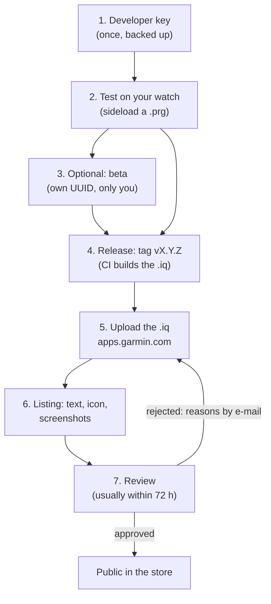

# Publishing to the Connect IQ Store

A step-by-step guide for the owner (milestone 6). Nothing has been submitted: every step in the
browser is yours. Checked against Garmin's documentation on 2026-11-15; each step names its
page. Where Garmin's pages say nothing, the guide says **not documented**: read it off the upload
form when you get there.

Garmin's pages used (all under `https://developer.garmin.com/`):

| Short | Page                                                                                                           |
|-------|----------------------------------------------------------------------------------------------------------------|
| GS    | [Getting Started](https://developer.garmin.com/connect-iq/connect-iq-basics/getting-started/)                  |
| FA    | [Your First App](https://developer.garmin.com/connect-iq/connect-iq-basics/your-first-app/)                    |
| PS    | [Publishing to the Store](https://developer.garmin.com/connect-iq/core-topics/publishing-to-the-store/)        |
| SA    | [Submit an App](https://developer.garmin.com/connect-iq/submit-an-app/)                                        |
| RG    | [App Review Guidelines](https://developer.garmin.com/connect-iq/app-review-guidelines/) (updated Oct 13, 2021) |
| BA    | [Beta Apps](https://developer.garmin.com/connect-iq/core-topics/beta-apps/)                                    |
| MP    | [Manifest and Permissions](https://developer.garmin.com/connect-iq/core-topics/manifest-and-permissions/)      |
| BG    | [Connect IQ brand guidelines](https://developer.garmin.com/brand-guidelines/connect-iq/)                       |
| DA    | [Connect IQ Agreement](https://developer.garmin.com/downloads/connect-iq/sdks/agreement.html) (Aug 6, 2024)    |



## 1. Your developer account

- **Who:** you sign in with your Garmin account. You must be at least 18 to create a developer
  account and submit an app (DA II.a.3), and give your real name or an alias that impersonates
  no one (RG 4.a).
- **Agreement:** using the SDK means accepting the Connect IQ Agreement (DA). You accepted it
  when downloading the SDK.
- **Upload:** in a browser, at <https://apps.garmin.com/en-US/developer/upload> (the **Submit an
  App** button of SA). The sign-up steps on that site are **not documented**.
- **Cost: none for a free app.** The USD 100 a year and the tax documents are only for Garmin's
  merchant service, for paid apps, which is optional (`connect-iq/monetization`, DA II.c.2).

## 2. The developer key

Every package for the store is signed with your key. **Updates must be signed with the same
key: "If you lose your original signing key you will not be able to update your app."** (GS)

1. Make it once, on your Mac. Garmin's command line (`reference-guides/monkey-c-command-line-setup`):

    ```sh
    openssl genrsa -out developer_key.pem 4096
    openssl pkcs8 -topk8 -inform PEM -outform DER -in developer_key.pem \
      -out developer_key.der -nocrypt
    ```

    It must be an RSA 4096-bit key (GS). VS Code's **Monkey C: Generate a Developer Key** makes
    the same.
2. **Back it up** in two places outside the repository, e.g. Vaultwarden (as an attachment) and
   an offline copy. Never commit it: `.gitignore` excludes `*.der` and `*.pem`.
3. **Give it to CI** as the repository's Actions secret `CONNECTIQ_DEVELOPER_KEY` (Forgejo:
   the repository's *Settings → Actions → Secrets*), base64-encoded:

    ```sh
    base64 -i developer_key.der | pbcopy   # macOS: copies it to the clipboard
    ```

    The release workflow writes it to a temporary file for the build and deletes it.
4. If the key may have leaked, tell Garmin at once (DA Exhibit A II).

## 3. The manifest

`watch/manifest.xml` already holds what the store reads:

| Setting             | Value                                         | Notes                                                                                                                                                                    |
|---------------------|-----------------------------------------------|--------------------------------------------------------------------------------------------------------------------------------------------------------------------------|
| App ID (`id`)       | `8afbecc92aad4e8594fb825489774f83`            | A UUID (MP). Keep it for every version: the store knows the app by it                                                                                                    |
| Type                | `watch-app`                                   | A device app (MP)                                                                                                                                                        |
| Name, launcher icon | `@Strings.AppName`, `@Drawables.LauncherIcon` | Resources, as MP requires; the compiler sizes the icon for each device (MP)                                                                                              |
| `minApiLevel`       | 3.3.0                                         | `BacklightOnTooLongException` needs 3.2.1 ([watch](watch.md))                                                                                                            |
| Products            | `d2mach1`                                     | "Make sure the manifest file specifies all products supported by the app" (PS); see below                                                                                |
| Permissions         | none                                          | Asked "at the time of installation" when there are any (MP); this app asks for none                                                                                      |
| Languages           | `eng`, `deu`                                  | MP: the languages declared are used when exporting, and "can impact what regions of the world your app is available in". The only string, the name, needs no translation |

- **Devices:** you must "accurately disclose which Garmin devices support your app" (RG 4.b).
  Add only devices tested at least in the simulator ([watch](watch.md#more-devices)).
- **Version: not documented.** The manifest has no version for an app. Reports in Garmin's
  forum (not documentation) say the upload form asks for it and refuses one that isn't new.
  Use the tag's version, e.g. `0.1.0` for `v0.1.0`.

## 4. Test it on your watch first

Sideload a build onto the D2 Mach 1 before submitting (FA, "Side Loading an App"): copy a
`.prg` into the watch's `GARMIN/APPS` folder. The [device tests](device-tests.md) describe it.
Garmin documents sideloading only for a `.prg`, not for the store's `.iq`.

After uploading (step 6) and while the review is pending, the app is hidden in the store, "but
you will be able to preview your app and download it yourself for testing" (PS).

## 5. Optional: a beta first

A beta lets you install the store's build through Garmin Connect before anyone else sees it
(BA):

- It needs **its own app ID**: a second UUID in the manifest, for the beta's uploads only.
- It's visible only in your account: "URLs to the beta will not be visible outside of your
  account." A way to invite other testers is **not documented**.
- It can be updated "as many times as you want".
- To release, switch back to the production ID and upload without the **Beta App** box. "The
  app will have a separate store identifier from your final app."

Worth it only to try the install from the store itself. The sideloaded `.prg` already covers the
app's behavior.

## 6. Build and upload the package

1. Make sure `CHANGELOG.md` has a section `## [X.Y.Z]` for the version: its text becomes the
   release notes, and the release fails without it.
2. Tag the version and push the tag:

    ```sh
    git tag -a v0.1.0 -m v0.1.0 && git push origin v0.1.0
    ```

    The release workflow ([deployment](deployment.md)) builds `wristmark-v0.1.0.iq` with
    `monkeyc --package-app` ("binaries for each supported device", PS), signed with your key,
    and attaches it to the Forgejo release. It also deploys the viewer.
3. Download the `.iq` from the release, open <https://apps.garmin.com/en-US/developer/upload>,
   and upload it. The site validates it first (PS).

Locally instead of the workflow:

```sh
CONNECTIQ_KEY=developer_key.der \
CONNECTIQ_HOME="$HOME/Library/Application Support/Garmin/ConnectIQ" \
  tools/build-watch.sh --package 9.3.0
```

## 7. The listing

After the package is validated, add the description, screenshots and other details (PS, SA).

### Images

| Asset                | Garmin's spec (BG)                                                                                                        | Ready                                                                                                                                                 |
|----------------------|---------------------------------------------------------------------------------------------------------------------------|-------------------------------------------------------------------------------------------------------------------------------------------------------|
| Store icon           | 500 x 500 px, sRGB, 10 px padding, centered; no black or transparent background, no text, no clip art, no Garmin branding | [`store-assets/icon-500.png`](store-assets/icon-500.png): marker 0 on blue, from `tools/generate-icon.mjs`                                            |
| On-device store icon | Optional, 128 x 128 px, sRGB; full color for AMOLED, the 64-color palette for memory-in-pixel displays                    | [`store-assets/icon-128.png`](store-assets/icon-128.png): its blue (#0055AA) is in the 64-color palette, so one icon serves both                      |
| Hero image           | Optional, 1440 x 720 px; separate images per language if it has text                                                      | Not made: best a photo of the watch and a phone showing a model, which needs the real thing                                                           |
| Screenshots          | **Not documented** (count, size, format). Forum posts mention 150 KB per screenshot                                       | The simulator's display: [`images/watch-d2mach1-simulator.png`](images/watch-d2mach1-simulator.png) (416 x 416, 3 KB). `tools/simulate.sh` makes more |

File formats and size limits are **not documented** either; check the form.

### Description

The description must be complete, "including any minimum requirements, limitations, or
dependencies" (RG 4.a), and say what other hardware or software the app needs. Here that's a
phone or laptop with a camera and a browser, and the viewer's address. The links must work:
"The app should not contain any broken links" (RG 2.a). So **submit only after the viewer is
deployed**. Explain your support policy too (RG 2.b).

The name of the watch may be used once the app is approved, to say accurately which devices it
works with; any other use of Garmin's name needs Garmin's written consent, and nothing may
suggest an affiliation with Garmin (DA VIII.a, RG 4.a). The drafts below name no Garmin product.

**English, short:**

```text
Your watch, in 3D. Point your phone's or laptop's camera at the watch and a 3D model comes alive
on your wrist: tonight's moon, the planets, a campfire, dice you roll with a flick.
```

**English, long:**

```text
Your watch, in 3D. WristMarkCompanion shows a marker on your watch's display. Open the viewer at
https://wristmark.apps.ciepiela.org in the browser of a phone or a laptop with a camera, point
the camera at the watch, and a 3D model stands on your wrist and follows it as you move.

50 models, one per marker: the moon in tonight's phase, the Earth with day and night as they are
now, the planets as they stand today, a world clock, a watch movement showing the time, an
hourglass, an attitude indicator that follows your wrist, a landing, a helicopter, a hot-air
balloon, a rocket launch, a windmill, a sailboat, a Ferris wheel lit at night, a bonsai in today's
season, a volcano, an atom, DNA, a Newton's cradle, a metronome, dice, a marble maze you tilt,
fireworks, a snow globe, a campfire, an aquarium, a lighthouse, a UFO, a toy train, a birthday cake,
a carousel, a race track, a satellite, a sundial, a jellyfish, butterflies, a lava lamp, a castle, a
house lit at night, a snowman, a puzzle cube that solves itself, a black hole, a treasure chest, a
rain cloud with a rainbow, a robot and a penguin.

Move your wrist and they react: flick it to roll the dice or launch a firework, shake it to stir
the snow or the fire, twist it to move the planets a month. Pinch to resize; full screen on a
phone.

On the watch, the up and down buttons switch the model; a tap or the start button cycles
through them. The display stays on while the marker is shown, as long as the watch allows; a
button press shows it again. Night mode (red light) works too.

What you need: a phone or laptop with a camera and a current web browser, and an internet
connection to load the viewer once. No account, nothing else to install.

Privacy: the watch app collects nothing and connects to nothing. The viewer runs entirely in
your browser: the camera images never leave your device. No ads, no tracking. Details:
https://wristmark.apps.ciepiela.org/privacy.html

Support: questions and problems by e-mail to contact@ciepiela.org.
```

**Deutsch, kurz:**

```text
Deine Uhr in 3D. Richte die Kamera von Handy oder Laptop auf die Uhr, und ein 3D-Modell erwacht
auf deinem Handgelenk: der Mond von heute Nacht, die Planeten, ein Lagerfeuer, Würfel per Dreh.
```

**Deutsch, lang:**

```text
Deine Uhr in 3D. WristMarkCompanion zeigt einen Marker auf dem Display deiner Uhr. Öffne den
Viewer unter https://wristmark.apps.ciepiela.org im Browser eines Handys oder Laptops mit
Kamera, richte die Kamera auf die Uhr, und ein 3D-Modell steht auf deinem Handgelenk und folgt
ihm, wenn du dich bewegst.

50 Modelle, eins pro Marker: der Mond in der Phase von heute Nacht, die Erde mit Tag und Nacht, wie
sie gerade sind, die Planeten, wie sie heute stehen, eine Weltzeituhr, ein Uhrwerk, das die Zeit
zeigt, eine Sanduhr, ein künstlicher Horizont, der deinem Handgelenk folgt, eine Landung, ein
Hubschrauber, ein Heißluftballon, ein Raketenstart, eine Windmühle, ein Segelboot, ein Riesenrad,
das nachts leuchtet, ein Bonsai in der Jahreszeit von heute, Würfel, ein Kugellabyrinth zum Kippen,
ein Vulkan, ein Atom, eine DNA, ein Kugelstoßpendel, ein Metronom, ein Feuerwerk, eine Schneekugel,
ein Lagerfeuer, ein Aquarium, ein Leuchtturm, ein UFO, eine Spielzeugeisenbahn, eine
Geburtstagstorte, ein Karussell, eine Rennstrecke, ein Satellit, eine Sonnenuhr, eine Qualle,
Schmetterlinge, eine Lavalampe, eine Burg, ein Haus, das nachts leuchtet, ein Schneemann, ein
Zauberwürfel, der sich selbst löst, ein Schwarzes Loch, eine Schatztruhe, eine Regenwolke mit
Regenbogen, ein Roboter und ein Pinguin.

Beweg dein Handgelenk, und sie reagieren: Ein schneller Dreh würfelt oder schießt eine Rakete,
Schütteln wirbelt den Schnee oder das Feuer auf, ein Drehen um die Uhr verschiebt die Planeten
um einen Monat. Mit zwei Fingern änderst du die Größe; auf dem Handy auch im Vollbild.

Auf der Uhr wechseln die Tasten oben und unten das Modell; Tippen oder die Start-Taste zeigt sie
nacheinander. Das Display bleibt an, solange der Marker gezeigt wird und die Uhr es zulässt; ein
Tastendruck zeigt ihn wieder. Der Nachtmodus (Rotlicht) funktioniert auch.

Du brauchst: ein Handy oder einen Laptop mit Kamera und einem aktuellen Webbrowser, und eine
Internetverbindung, um den Viewer einmal zu laden. Kein Konto, sonst nichts zu installieren.

Datenschutz: Die App auf der Uhr sammelt nichts und verbindet sich mit nichts. Der Viewer läuft
ganz in deinem Browser: Die Kamerabilder verlassen dein Gerät nie. Keine Werbung, kein
Tracking. Details: https://wristmark.apps.ciepiela.org/privacy.html

Support: Fragen und Probleme per E-Mail an contact@ciepiela.org.
```

How the form takes a second language is **not documented**. The manifest declares both
(step 3), which MP says decides the regions.

## 8. What the review might look at

Nothing in the guidelines is about markers, codes or apps that work with a website. The rules
closest to this app:

| Guideline                                                                                               | This app                                                                                                                                                                          |
|---------------------------------------------------------------------------------------------------------|-----------------------------------------------------------------------------------------------------------------------------------------------------------------------------------|
| Apps must not hurt "battery life, device performance" (RG 2.a)                                          | The display is held on only while the app is open, and the system's burn-in limit stays in force ([watch](watch.md#keeping-the-display-on)). The device tests measure battery use |
| Disclose requirements and dependencies (RG 4.a)                                                         | The description names the phone or laptop, the browser and the address                                                                                                            |
| "fully completed, tested, and ready for use", no broken links (RG 2.a)                                  | Submit after the device tests and with the viewer deployed                                                                                                                        |
| No "advertising-focused content that serves primarily to drive affiliate traffic to a website" (RG 1.a) | The website is the app's other half, with no ads or affiliates; say so plainly in the description                                                                                 |
| No claimed affiliation with Garmin, no Garmin branding in the icon (RG 4.a, BG)                         | None                                                                                                                                                                              |
| Garmin may remove "a potentially harmful app ... even if there is no specific violation" (RG)           | -                                                                                                                                                                                 |

## 9. Name and trademarks

- **Garmin's rules:** no use of Garmin's name or marks in marketing without written consent;
  accurate statements of compatibility are allowed once the app is approved (DA VIII.a). An
  explicit rule on device names in an app's name is **not documented**: keep them out of it.
- **The store name is WristMarkCompanion.** "wristmark" alone is in use elsewhere: Apple's App
  Store lists an iPhone app **WristMark**, a meeting recorder with a wrist app (checked
  2026-11-15, by a web search), so the app was renamed before its first upload. The repository is
  `wristmarkcompanion`; the viewer's address and the file names keep the shorter `wristmark`,
  which isn't shown in the store. No trademark registration for either name turned up in that
  search, which doesn't replace a registry search: EUIPO's eSearch / TMview and the USPTO's
  trademark search in classes 9 and 42.

## 10. Privacy

- A privacy policy is required "If your Application will collect any data from users" (DA
  Exhibit A I.a). The watch app collects nothing and has no permissions, so the store's rule
  doesn't apply to it.
- The viewer still gets a privacy page, which the description links to: what stays in the
browser, and what the app host's proxy logs
([deployment](deployment.md#what-the-privacy-page-must-say)). It's `viewer/public/privacy.html`.
Keep its address: if it ever moves, the old one must redirect (DA Exhibit A I.a).

## 11. Review and updates

- "reviews are completed within 72 hours", apart from holidays (PS). You get a notification
  when the app is approved.
- On rejection, Garmin e-mails "specific reasons", and you can fix and resubmit (PS).
- **Updates:** a new tag, a new `.iq` signed with the same key, uploaded to the same app. How
  the form handles updates, and whether each is reviewed again, is **not documented** (PS
  covers only the first version).

## Checklist before submitting

- [ ] Device tests done, results in [device tests](device-tests.md), nothing open that would
      fail RG 2.a (battery, stability).
- [ ] The developer key made, backed up twice, `CONNECTIQ_DEVELOPER_KEY` set.
- [ ] The name checked in the trademark registries (section 9).
- [ ] The viewer deployed at `https://wristmark.apps.ciepiela.org`, with its privacy page.
- [ ] `CHANGELOG.md` has the version's section; the tag pushed; the release has the `.iq`.
- [ ] The `.iq` sideloaded or downloaded from the pending listing and tried on the watch.
- [ ] Listing: name, WristMarkCompanion, the descriptions above, the icon, screenshots.
- [ ] Nothing in the listing claims a link to Garmin.
