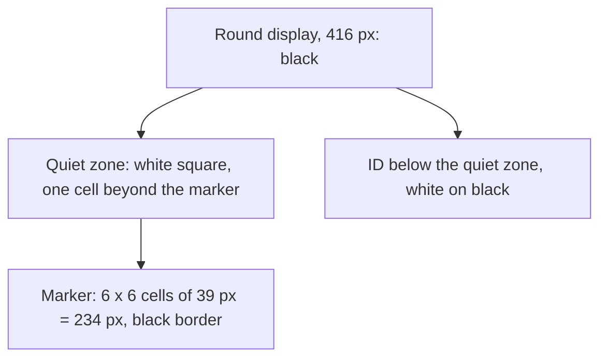

# Watch app

A Connect IQ **device app** (`type="watch-app"`, `watch/manifest.xml`) that shows one marker of
OpenCV's DICT_4X4_50 ([002](decisions/002-marker-dictionary.md)). First target: the D2 Mach 1
(`d2mach1`).

**Status:** compiled in CI for the D2 Mach 1 with the strict type check ([CI](ci.md),
`tools/build-watch.sh`), and run in the simulator (below). Not yet run on a real watch.
`viewer/test` tests what needs no SDK: the watch's table equals the detector's codes, and the
layout below, drawn as `MarkerView` draws it, is detected for every ID.

## In the simulator


The D2 Mach 1's display in the simulator (SDK 9.3.0), on 2026-11-15: marker 0 in its white quiet
zone, whose corners the round display cuts off, and the ID below it. The app used 7.6 of 763.6 kB
of memory. js-aruco2, set up as the viewer sets it up, detects ID 0 in this image, with a side of
233 px (6 cells of 39 px). Everything outside the display is masked black: the simulator draws
Garmin's picture of the watch around it, which is part of the SDK.

To run it again (needs Docker, and the SDK, the device and its fonts from the SDK Manager):

```sh
tools/build-watch.sh 9.3.0
tools/simulate.sh 9.3.0 d2mach1 watch/bin/wristmark-d2mach1.prg screen.png
```

`tools/simulate.sh` runs the simulator in an Ubuntu 22.04 container
(`tools/simulator/Dockerfile`) with a virtual display, and fails if the app reports an error or
crashes. Without the device's fonts, text fails with "Invalid Font Specified".

## Layout



- **Drawn with rectangles**, not bitmaps (`Dc.fillRectangle`), so one code path fits any screen.
- **Cell size:** the largest whole number of pixels for which the marker's corners stay at least
  one cell inside the round display: `cell = floor(r / (6 / √2 + 1))`. On 416 px (`r` = 208):
  39 px, so the marker is 234 px.
- **Quiet zone:** a white square one cell wider than the marker on every side. Its own corners
  fall outside the round display. Along the diagonals the marker's corners keep 42 px of white
  to the display's edge, more than a cell.
- **Everything else is black:** an AMOLED display lights only the white pixels, so this draws
  less power and less burn-in than a white screen.
- **The ID** is drawn below the quiet zone in `FONT_XTINY` (30 px on this device), outside the
  area the detector reads.

### Physical size

| Device    | Display       | Pixels    | Marker (6 cells) | Marker in mm  |
|-----------|---------------|-----------|------------------|---------------|
| D2 Mach 1 | 1.3″, 33.0 mm | 416 × 416 | 234 px           | about 18.6 mm |

The pixel figures are from Garmin's
[device reference](https://developer.garmin.com/connect-iq/device-reference/d2mach1/). The
display's diameter comes from spec sheets
([the5krunner](https://the5krunner.com/specs/garmin/d2-mach-1/),
[AVweb](https://www.avweb.com/?p=276908)), not from Garmin. The [device tests](device-tests.md) include
measuring the marker on the watch with a ruler. The viewer's default marker size is 20 mm until
then (`?size=18.6` on its URL uses this one).

## Controls

`MarkerDelegate`, a `WatchUi.BehaviorDelegate`:

| Input                                    | Action                                                                    |
|------------------------------------------|---------------------------------------------------------------------------|
| Down button, swipe up (`onNextPage`)     | Next ID with a model (`MarkerContent`); the last wraps to the first       |
| Up button, swipe down (`onPreviousPage`) | Previous ID with a model                                                  |
| Enter button, tap (`onSelect`)           | Start or stop the automatic cycle (5 s per marker); the label says `auto` |
| Back                                     | Leave the app (the system's default)                                      |

## Keeping the display on

From Garmin's API reference for
[`Attention.backlight`](https://developer.garmin.com/connect-iq/api-docs/Toybox/Attention.html),
checked on 2026-11-15:

- "The backlight will always respect the backlight timeout settings on the device."
- "Calling this repeatedly can hold the display on, but if the product has burn in protection an
  exception will be thrown if you attempt to keep the display enabled for too long (e.g. over 1
  minute)." The exception is
  [`Attention.BacklightOnTooLongException`](https://developer.garmin.com/connect-iq/api-docs/Toybox/Attention/BacklightOnTooLongException.html),
  available from API level 3.2.1.
- A Float argument (0.0 to 1.0) sets the brightness, from Connect IQ 3.2.1 on.

What the app does with this (`MarkerView.keepOn`):

- **While it's shown,** it calls `Attention.backlight(true)` every 5 seconds, so the display
  stays on past the user's timeout.
- **When the system refuses** (`BacklightOnTooLongException`), it stops asking and the display
  dims as the system decides. It doesn't catch and retry: that is the protection working.
- **Any input** (a button, a swipe, a tap) asks again, so a press gives the next session.

This is the legitimate way to extend a session: the app holds the display only while it's in
use, the system's limit stays in force, and the user restarts a session by pressing a button.

**Open, for the device tests:** how long the D2 Mach 1 actually holds the display before
refusing, whether a press resets the limit, and whether the app keeps the marker visible
(dimmed) or the display turns off after a refusal. The [device tests](device-tests.md)
(milestone 4) measure the session length.

## Glance: not added

A glance is a one-line preview in the widget loop, with 64 KB of memory on this device (device
reference). The marker needs the full screen to be detectable at a distance, so a glance can't
show it, and the app needs no status that a glance could summarize. Starting the app from the
apps list or a hotkey is enough.

## Memory and permissions

- **Memory:** a watch app may use 786 432 bytes on the D2 Mach 1 (device reference). The app
  holds a 50-entry table of numbers, two timers and draws at most 37 rectangles (36 cells and
  the quiet zone). It loads no
  bitmaps or resources besides its name.
- **Permissions:** none (`<iq:permissions/>`). Garmin's
  [permission list](https://developer.garmin.com/connect-iq/core-topics/manifest-and-permissions/)
  doesn't cover drawing, input, timers or `Attention`.
- **`minApiLevel` 3.3.0:** `BacklightOnTooLongException` needs 3.2.1. Every device the app is
  meant for has a newer level.

## More devices

The goal is **as many devices as possible**. The D2 Mach 1 comes first; others are added once it
works on the watch (milestone 4). What differs between devices, and how the app is prepared:

| Difference                                             | Today                                                                  | For many devices                                                                                           |
|--------------------------------------------------------|------------------------------------------------------------------------|------------------------------------------------------------------------------------------------------------|
| Screen size and shape                                  | The layout is computed from the screen's size, drawn with rectangles   | Rectangular screens fit the marker in the shorter side; checked in the simulator per shape                 |
| Display type (AMOLED, memory-in-pixel)                 | Black and white only, which every type shows                           | The display held on (`Attention.backlight`) is for AMOLED; on others the screen stays on anyway            |
| Launcher icon size (`launcherIcon` in `compiler.json`) | 60x60, the D2 Mach 1's                                                 | One icon per size, through resource qualifiers, generated by `tools/generate-icon.mjs`                     |
| API level                                              | `minApiLevel` 3.3.0                                                    | Lower only with `has` checks around the newer calls; older devices aren't worth much code                  |
| Build time                                             | One `monkeyc` run, one Java start, per device                          | One `--package-app` build (`.iq`) covers every product of the manifest                                     |
| Device files                                           | `connectiq-update` on `anvil` installs them (all devices of 9.3.0 are) | The manifest's products could be generated from the installed devices' `compiler.json` (type, API, screen) |

The right-hand column is a plan, not checked against Garmin's documentation yet.
