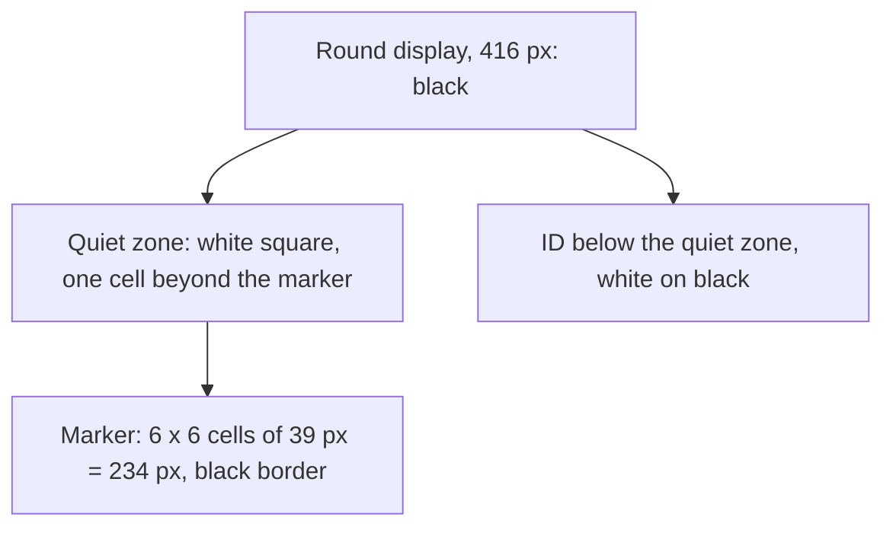

# Watch app

A Connect IQ **device app** (`type="watch-app"`, `watch/manifest.xml`) that shows one marker of
OpenCV's DICT_4X4_50 ([002](decisions/002-marker-dictionary.md)). First target: the D2 Mach 1
(`d2mach1`).

**Status:** compiled in CI for the D2 Mach 1 with the strict type check ([CI](ci.md),
`tools/build-watch.sh`), and run in the simulator (below). Not yet run on a real watch.
`viewer/test` tests what needs no SDK: the watch's table equals the detector's codes, and the
layout below, drawn as `MarkerView` draws it, is detected for every ID.

## In the simulator


The D2 Mach 1's display in the simulator (SDK 9.3.0), on 2026-11-15: marker 0 in its white quiet
zone, whose corners the round display cuts off, and the ID below it. The app used 7.6 of 763.6 kB
of memory. js-aruco2, set up as the viewer sets it up, detects ID 0 in this image, with a side of
233 px (6 cells of 39 px). Everything outside the display is masked black: the simulator draws
Garmin's picture of the watch around it, which is part of the SDK.

To run it again (needs Docker, and the SDK, the device and its fonts from the SDK Manager):

```sh
tools/build-watch.sh 9.3.0
tools/simulate.sh 9.3.0 d2mach1 watch/bin/wristmark-d2mach1.prg screen.png
```

`tools/simulate.sh` runs the simulator in an Ubuntu 22.04 container
(`tools/simulator/Dockerfile`) with a virtual display, and fails if the app reports an error or
crashes. Without the device's fonts, text fails with "Invalid Font Specified".

## Layout



- **Drawn with rectangles**, not bitmaps (`Dc.fillRectangle`), so one code path fits any screen.
- **Cell size:** the largest whole number of pixels for which the marker's corners stay at least
  one cell inside the round display: `cell = floor(r / (6 / √2 + 1))`. On 416 px (`r` = 208):
  39 px, so the marker is 234 px.
- **Quiet zone:** a white square one cell wider than the marker on every side. Its own corners
  fall outside the round display. Along the diagonals the marker's corners keep 42 px of white
  to the display's edge, more than a cell.
- **Everything else is black:** an AMOLED display lights only the white pixels, so this draws
  less power and less burn-in than a white screen.
- **The ID** is drawn below the quiet zone in `FONT_XTINY` (30 px on this device), outside the
  area the detector reads.

### Physical size

| Device    | Display       | Pixels    | Marker (6 cells) | Marker in mm  |
|-----------|---------------|-----------|------------------|---------------|
| D2 Mach 1 | 1.3″, 33.0 mm | 416 × 416 | 234 px           | about 18.6 mm |

The pixel figures are from Garmin's
[device reference](https://developer.garmin.com/connect-iq/device-reference/d2mach1/). The
display's diameter comes from spec sheets
([the5krunner](https://the5krunner.com/specs/garmin/d2-mach-1/),
[AVweb](https://www.avweb.com/?p=276908)), not from Garmin. The [device tests](device-tests.md) include
measuring the marker on the watch with a ruler. The viewer's default marker size is 20 mm until
then (`?size=18.6` on its URL uses this one).

## Controls

`MarkerDelegate`, a `WatchUi.BehaviorDelegate`:

| Input                                                                | Action                                                                    |
|----------------------------------------------------------------------|---------------------------------------------------------------------------|
| Down button, swipe up (`onNextPage`)                                 | Next ID with a model (`MarkerContent`); the last wraps to the first       |
| Up button, swipe down (`onPreviousPage`)                             | Previous ID with a model                                                  |
| Start button pressed, tap (`onKeyReleased`, `onSelect`)              | Start or stop the automatic cycle (5 s per marker); the label says `auto` |
| Start button held 0.8 s (`onKeyPressed`, a timer)                    | The viewers' menu: pair a viewer, forget one or all                       |
| Up held, the menu button, a long press (`onMenu`)                    | The same menu, where the watch doesn't keep it for its own controls       |
| Long touch on the display (`onHold`)                                 | The same menu                                                             |
| Start or tap on the Viewers screen, after the last marker (`select`) | The same menu: the way no button setting of the watch takes               |
| Back                                                                 | Leave the app (the system's default)                                      |

## Keeping the display on

From Garmin's API reference for
[`Attention.backlight`](https://developer.garmin.com/connect-iq/api-docs/Toybox/Attention.html),
checked on 2026-11-15:

- "The backlight will always respect the backlight timeout settings on the device."
- "Calling this repeatedly can hold the display on, but if the product has burn in protection an
  exception will be thrown if you attempt to keep the display enabled for too long (e.g. over 1
  minute)." The exception is
  [`Attention.BacklightOnTooLongException`](https://developer.garmin.com/connect-iq/api-docs/Toybox/Attention/BacklightOnTooLongException.html),
  available from API level 3.2.1.
- A Float argument (0.0 to 1.0) sets the brightness, from Connect IQ 3.2.1 on.

What the app does with this (`MarkerView.keepOn`):

- **While it's shown,** it calls `Attention.backlight(true)` every 5 seconds, so the display
  stays on past the user's timeout.
- **When the system refuses** (`BacklightOnTooLongException`, or anything else the call throws:
  an uncaught exception would close the app), it stops asking and the display dims as the
  system decides. It doesn't retry: on AMOLED that is the firmware's burn-in protection, which
  no API overrides. The ID line then says how long the display was held (`ID 7 - lit 63s`)
  until the next input, so a device test reads the limit off the watch.
- **Any input** (a button, a swipe, a tap) and any command from a paired viewer asks again, so a
  press gives the next session.
- **Longer without the app:** the watch's own display timeout setting decides how long the
  display stays on when nobody holds it; the longest one helps after a refusal.

This is the legitimate way to extend a session: the app holds the display only while it's in
use, the system's limit stays in force, and the user restarts a session by pressing a button.

**Open, for the device tests:** how long the D2 Mach 1 actually holds the display before
refusing, whether a press resets the limit, and whether the app keeps the marker visible
(dimmed) or the display turns off after a refusal. The [device tests](device-tests.md)
(milestone 4) measure the session length.

## Glance: not added

A glance is a one-line preview in the widget loop, with 64 KB of memory on this device (device
reference). The marker needs the full screen to be detectable at a distance, so a glance can't
show it, and the app needs no status that a glance could summarize. Starting the app from the
apps list or a hotkey is enough.

## Memory and permissions

- **Memory:** a watch app may use 786 432 bytes on the D2 Mach 1 (device reference). The app
  holds a 50-entry table of numbers, two timers and draws at most 37 rectangles (36 cells and
  the quiet zone). It loads no
  bitmaps or resources besides its name.
- **Permissions:** none (`<iq:permissions/>`). Garmin's
  [permission list](https://developer.garmin.com/connect-iq/core-topics/manifest-and-permissions/)
  doesn't cover drawing, input, timers or `Attention`.
- **`minApiLevel` 3.3.0:** `BacklightOnTooLongException` needs 3.2.1. Every device the app is
  meant for has a newer level.

## Devices {#devices}

The app is built for **every device whose Connect IQ can run it**, not one watch: watches, and
bike computers (Edge) and handhelds (GPSMAP, Montana, Oregon, Rino, eTrex) too, whose display
shows the marker as well. The list is made from the SDK's device files, so a device Garmin adds
is found, not typed in.

- **The list,** `watch/devices.json`: `tools/generate-devices.mjs --sdk <Devices>` reads each
  device's `compiler.json` and keeps those with device apps (`watchApp`), Connect IQ 3.3.0 or
  later (the manifest's `minApiLevel`; the newest of its firmware versions, or its
  `deviceGroup`, which is the API level), and at least 128 KB for a device app. It prints the
  devices it leaves out and why. CI's watch job runs it with `--check` against the device
  files installed on `anvil` (`connectiq-update`, docs/ci.md): a new or changed device fails it,
  and the log shows the list to commit.
- **From the list:** the manifest's `<iq:products>` and `watch/devices.jungle`
  (`tools/generate-devices.mjs`, checked in the checks job), and a launcher icon for each size
  in `watch/resources-launcher-<w>x<h>/` (`tools/generate-icon.mjs`). The D2 Mach 1's 60x60 is
  the default in `watch/resources/`.
- **The build:** one `monkeyc --package-app` run compiles and type-checks every device
  (`wristmark-test.iq`), so a hundred devices cost one Java start; a `.prg` to sideload is made
  for the D2 Mach 1, or the devices `WATCH_DEVICES` names.

The marker's layout follows the display (`MarkerView`, `PairingView`):

| Display                                | Marker                                                                 | ID               |
|----------------------------------------|------------------------------------------------------------------------|------------------|
| Round, semi-round                      | Largest whole cell whose corners stay a cell inside the circle         | Below            |
| Rectangular (Venu Sq, Edge, handhelds) | The marker and its quiet zone in the shorter side                      | Below            |
| With a subscreen (Instinct)            | In the room below the subscreen, two cells of margin for the cut edges | In the subscreen |

What the viewer assumes, and what that means on other watches:

- **The marker's side is taken as 20 mm** (the D2 Mach 1's 18.6). On another watch it is
  larger or smaller, and the viewer's distance is off by the same share. The model still stands
  on the marker, as large relative to it as on the D2 Mach 1: orientation and position on the
  image don't depend on the size. The gestures' movement thresholds (millimeters a second) are
  off by that share too.
- **The black display under the model** is a circle 416/234 marker sides across, the D2 Mach
  1's. On a round display with the same layout it fits; on a rectangular one it is a circle
  inside the rectangle, and on the Instinct it is offset from the subscreen.
- **Memory-in-pixel and black-and-white displays** show the marker as well: it is black and
  white only. The display held on (`Attention.backlight`) matters on AMOLED; others stay on.

Not checked yet: the layout in the simulator on a rectangular display and on an Instinct, and
memory on the smallest devices (`tools/simulate.sh` with their IDs).
